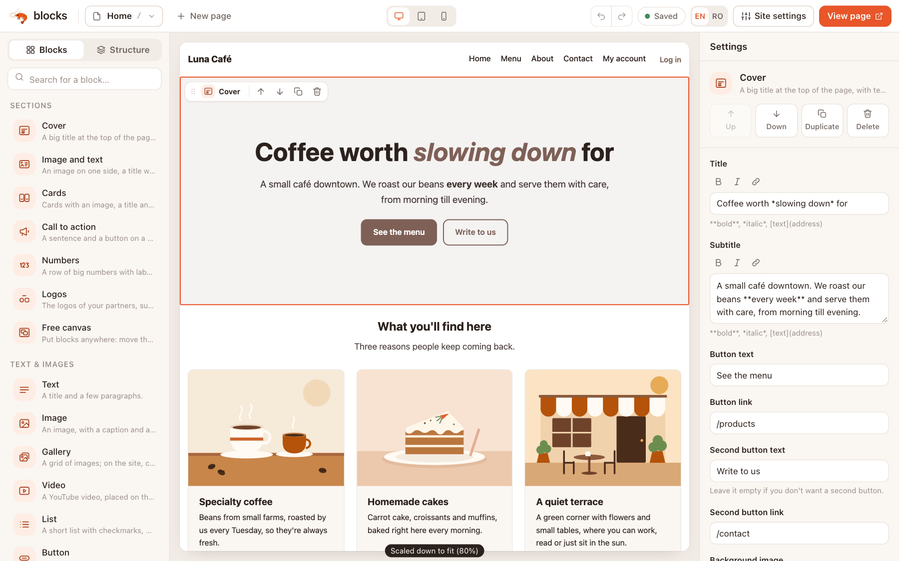
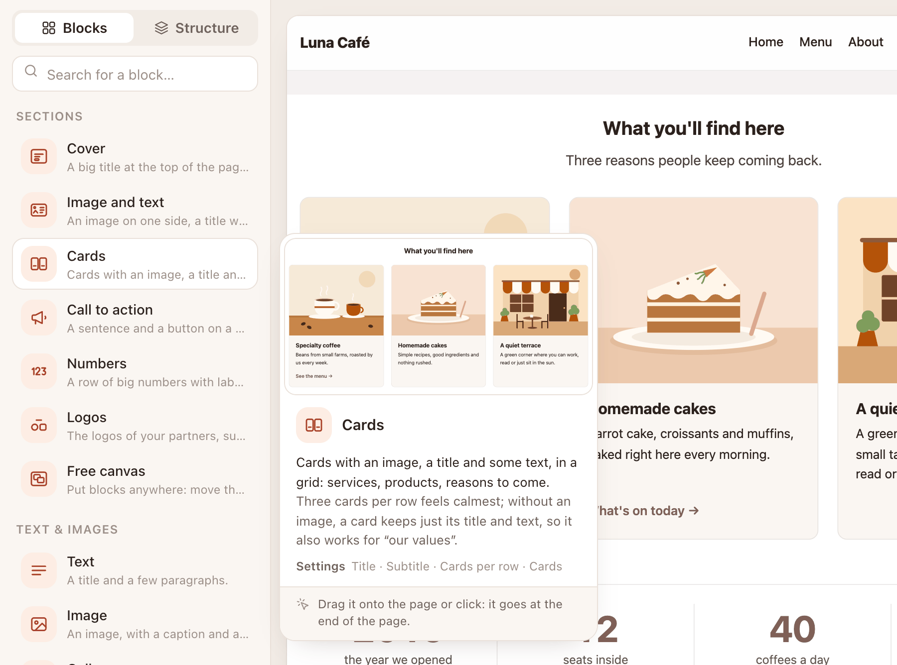
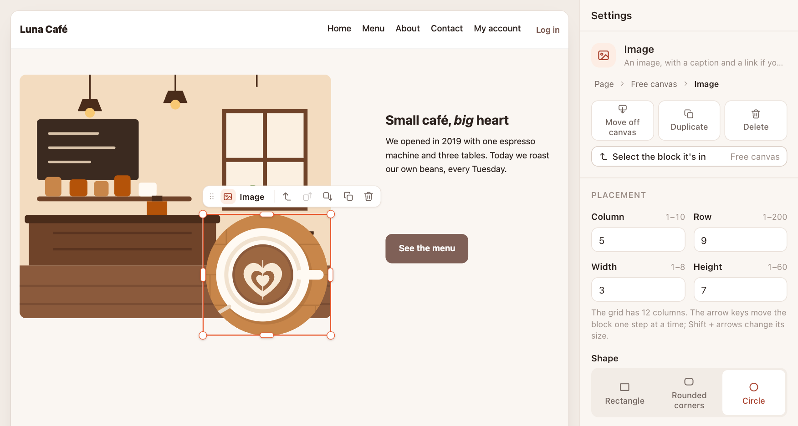

<div align="center">


# Blocks

**Build websites from blocks. Simple, yet everything possible.**

[](https://github.com/blocks-web/blocks/actions/workflows/test.yml)
[](LICENSE)
[](https://nodejs.org)
[](package.json)

**[See the live demo](https://blocks-web.github.io/blocks/)**

</div>

<p align="center">
  
</p>

Blocks is a website builder that runs on your own computer. If you don't write code, you drag blocks onto a page and type your text. If you do, every block is one plain JavaScript file that you can read, copy and change. No database, no build step, no npm packages: just Node.js and your files.

## Start in 3 commands

You need [Node.js](https://nodejs.org) 22 or newer.

```bash
git clone https://github.com/blocks-web/blocks.git
cd blocks
node blocks.js dev
```

No git? On GitHub, click **Code** → **Download ZIP**, unzip it, open a terminal in that folder and run `node blocks.js dev`.

Then open two addresses in your browser:

- **The editor:** <http://localhost:3000/_editor/>
- **Your site:** <http://127.0.0.1:3000/>

They are two different addresses on purpose: code pasted into a page (a widget, a script) can never reach the editor. If port 3000 is busy, start with `node blocks.js dev --port 3001`.

The project comes with a small demo site for Luna Café, an imaginary café, so you can try everything right away. Or look around first: [the live demo](https://blocks-web.github.io/blocks/) is the same site, published as static files (logging in, signing up and the contact form need the server, so they're switched off there).

## Two ways in

### I don't write code

Everything you do in Blocks is one of three gestures:

1. **Drag** a block from the left onto the page, or press **+** right where you want it.
2. **Click** it.
3. **Type**: change its text, images and colors in the panel on the right.

Everything saves by itself, and <kbd>Ctrl</kbd>/<kbd>Cmd</kbd> + <kbd>Z</kbd> undoes any edit to the page.

<p align="center">
  
</p>
<p align="center"><em>Hover over a block to see what it does, with a live preview.</em></p>

<p align="center">
  
</p>
<p align="center"><em>On the Free canvas, blocks go anywhere: move them, resize them, give them a shape, layer them. On a phone, they line up one under the other by themselves.</em></p>

In longer texts you can write `**bold**`, `*italic*` and `[a link](/contact)`. An empty line starts a new paragraph, and lines that start with `- ` become a list. The buttons above the field do it for you.

The header and the footer are shared: you edit them once, and they show on every page. **Site settings** holds the site's name, language, colors and font.

### I'm a developer

A block is one file in `components/`, and a page is one JSON file in `pages/` that you can also edit by hand. Here is a complete block:

```js
// components/notice.js
import { html, inline } from "../core/html.js";

export default {
  name: "Notice",
  category: "My blocks",
  icon: "star",
  description: "A short notice in a colored band.",

  props: {
    text: { type: "text", format: true, label: "Text", default: "Open this **Sunday**, 9 to 5." },
    tone: {
      type: "choice",
      label: "Color",
      options: [{ value: "calm", label: "Calm" }, { value: "bright", label: "Bright" }],
      default: "calm",
    },
  },

  html(p) {
    return html`<div class="b-block notice notice--${p.tone}">
      <div class="b-container">${inline(p.text)}</div>
    </div>`;
  },

  css: `
    .notice { text-align: center; }
    .notice--calm { background: var(--surface); }
    .notice--bright { background: var(--primary); color: #fff; }
  `,
};
```

Save it, and it shows up in the palette right away. The editor builds the settings panel from `props`. Everything inside `${...}` is escaped, and a `choice` is always one of its options, so nothing a person types can slip into your HTML or CSS.

Need more? It's all in the same file, or next to it:

- **JavaScript in the browser:** add `js(el, p, api) { ... }`. It runs for every block of this kind on the page.
- **Logic on the server** (save data, call a service): put `notice.server.js` next to it. Its code never reaches the browser.

  ```js
  // components/notice.server.js → answers POST /api/c/notice/like
  export default {
    "POST /like": async (request, ctx) => {
      ctx.limit({ name: "likes", max: 5, minutes: 10 });
      ctx.data("likes").add({ page: String(request.body.page ?? "").slice(0, 200) });
      return { likes: ctx.data("likes").count() };
    },
  };
  ```

- **Blocks inside your block:** add `slots: { content: "Content" }` and write `${ctx.slot("content")}` in `html(p, ctx)`. With `ctx.slot("content", { free: true })` they can sit anywhere, as on the Free canvas: the core takes care of the grid, the shapes and the phone layout.
- **A mistake?** Syntax errors (with the line number), unknown field types and misspelled keys (`descripton`, `Props`) show up in the terminal. A broken block never takes the page down with it.

To start a new block from the template, run:

```bash
node blocks.js component product-price
```

<details>
<summary>The file it creates: <code>components/product-price.js</code></summary>

```js
import { html, inline, paragraphs } from "../core/html.js";

// The “Product price” block. Save the file and the editor loads it by itself.
export default {
  name: "Product price", // the name in the palette; it can have spaces and accents (e.g. “Café menu”)
  category: "My blocks", // the first palette category; any other name becomes a category of your own, also at the top
  icon: "block", // an icon name from docs/DESIGN.md, or an emoji
  description: "Say in a few words what it does.",
  tip: "A short tip for whoever uses the block.", // shown on hover, after the description

  // What people can change in the panel on the right.
  // format: true → the title accepts **bold**, *italic* and [link](/page); a "longtext" always does.
  props: {
    title: { type: "text", format: true, label: "Title", default: "Hello!" },
    text: { type: "longtext", label: "Text", default: "Write something here.\n\nAn empty line starts a new paragraph." },
  },

  // The block's HTML. Everything inside ${...} is escaped automatically.
  // b-block adds space above and below (it goes away inside sections and columns), b-container sets the width.
  html(p) {
    return html`<div class="b-block"><div class="b-container">
      <h2>${inline(p.title)}</h2>
      ${paragraphs(p.text)}
    </div></div>`;
  },

  // .c-product-price wraps every block of this kind: put it in front of your rules so they don't touch the rest of the page.
  css: `
    .c-product-price h2 { color: var(--primary); }
  `,

  // Optional: JavaScript that runs in the browser for each block.
  // js(el, p, api) {
  //   el.querySelector("h2").addEventListener("click", () => alert(p.title));
  // },
};
```

</details>

Read on:

- [docs/ARCHITECTURE.md](docs/ARCHITECTURE.md): the whole contract (components, pages, the server, the editor, safety).
- [docs/DESIGN.md](docs/DESIGN.md): how Blocks looks and talks.
- [docs/PHILOSOPHY.md](docs/PHILOSOPHY.md): the rules behind every decision.
- [CONTRIBUTING.md](CONTRIBUTING.md): how to help.

## Why Blocks

**If you make websites for other people, you know the story.** The site is finished, and then every small change comes back to you: a new price, a new photo, one more page. Hand over a classic CMS, and a year later it's running twenty plugins, three of them abandoned, one update away from a broken layout. Hand over a hosted site builder, and you're both stuck with a monthly bill and a site you can't take with you.

Blocks is built for that situation:

- **The owner edits it alone.** Three gestures, plain words, and every edit can be undone. You make the blocks once; the owner drags, clicks and types.
- **No lock-in.** A site is a folder of ordinary files: JSON pages, JavaScript blocks and your images. Publish it as static HTML, or run it on any server with Node.js. Take it wherever you like.
- **No plugin rot.** No npm packages, no build step, no database. Every site carries its own copy of Blocks, so nothing changes under your feet.
- **Code you can read.** The core, the server and the editor are plain JavaScript, commented in plain English. Open any file and follow along.

## What's inside

**Editing**

- Drag and drop from the palette, or **+** right where you want a block; search finds blocks by everyday words.
- Autosave, with undo and redo for every edit.
- A Structure view of the page, and desktop, tablet and phone widths.
- A shared header and footer, edited once for every page.
- The Free canvas: blocks placed anywhere, resized, shaped and layered, and stacked by themselves on phones.
- The editor speaks English or Romanian (the **EN / RO** switch in the top bar).

**36 blocks, ready to use**

- **Sections:** Cover, Image and text, Cards, Call to action, Numbers, Logos, Free canvas
- **Text & images:** Text, Image, Gallery, Video, List, Button, Quote
- **Lists:** Prices, Team, FAQ, News, Events, Timeline, Press
- **Contact:** Address, Opening hours, Map, Social media, Form
- **Members:** Log in, Sign up, My account, Members only
- **Page:** Header, Footer, Section, Columns, Spacer, Embed code

**Members and forms**

- Accounts are built in: a page, or part of one, can be for members only.
- Forms with the fields you choose. Messages are saved on your server and read with `node blocks.js messages`.
- Manage accounts from the terminal: `node blocks.js account list`.

**For developers**

- One file per block, loaded again as soon as you save it.
- Server routes per block, simple JSON collections in `data/`, and rate limits in one line.
- Visitor messages in English or Romanian, following the site's language.
- Tests run with `npm test`, on Node's own test runner.

## Security

- The editor runs only on your computer, never on the public server.
- Everything a visitor types is treated as text, never as code, and every page has strict safety rules (Content-Security-Policy), relaxed only on pages where you paste in your own code.
- Passwords are stored as scrypt hashes, sessions live in `HttpOnly` cookies, and after too many wrong attempts, logging in is paused for a while.
- Found a problem? Please report it privately, as described in [SECURITY.md](SECURITY.md).

## Publishing

You edit on your computer, then publish. There are two ways:

- **Static files** (no accounts, no forms): `node blocks.js build` writes the site to `dist/`. Upload that folder to any web host. For a site in a subfolder, such as GitHub Pages (`https://name.github.io/project/`), use `node blocks.js build --base /project/`. The export tells you what won't work without a server, and leaves out the members-only pages and the menu links to them.
- **With the server** (accounts, forms, members-only pages): run `node blocks.js start` on your server. Useful environment variables: `PORT`, `HOST`, `COOKIE_SECURE=1` (when the site is on HTTPS) and `TRUST_PROXY=1` (behind a proxy such as nginx).

<details>
<summary>Behind nginx</summary>

The proxy must pass on the site's real address; otherwise the server turns down forms and logins ("Request blocked: it came from another site."):

```nginx
location / {
  proxy_pass http://127.0.0.1:3000;
  proxy_set_header Host $host;
  proxy_set_header X-Forwarded-For $proxy_add_x_forwarded_for;
  proxy_set_header X-Forwarded-Proto $scheme;
}
```

</details>

All commands: `node blocks.js help`.

## Status

**Preview 0.1 — feedback welcome.** Blocks works and is well tested, but it's young, and names and files may still change before 1.0. The most useful feedback is the simplest: what confused you, what you expected to find, and what you built.

- Something broken? [Report a bug](https://github.com/blocks-web/blocks/issues/new?template=bug.yml).
- An idea, or something missing? [Share an idea](https://github.com/blocks-web/blocks/issues/new?template=idea.yml).

## License

[MIT](LICENSE). Use it, change it, build sites for your clients with it.
